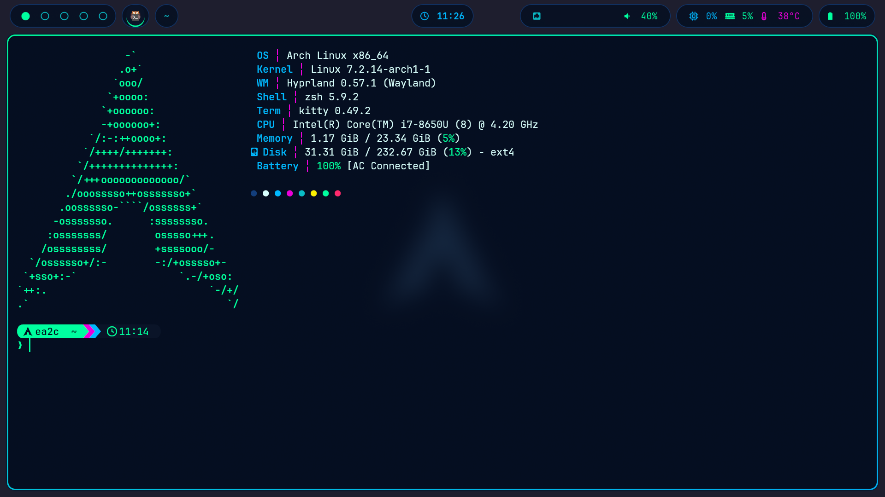
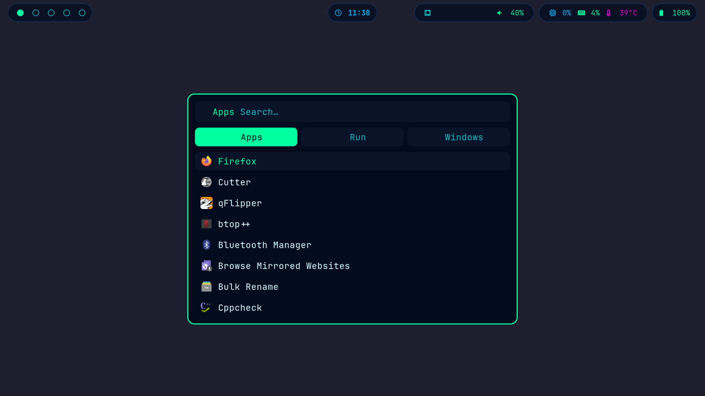
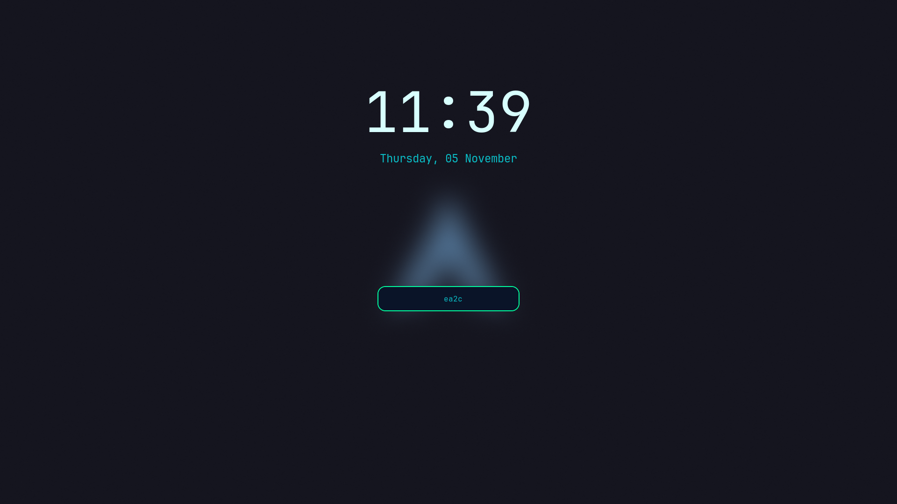

# archbtw — Cyberpunk Neon Hyprland rice

My Arch Linux desktop: Hyprland on Wayland, themed end-to-end in one neon palette, from the boot splash to the lock screen.

**Why Arch + BlackArch + a Kali VM:** Arch for a minimal desktop I fully understand, BlackArch repos for security tools on demand, and a Kali VM for anything I'd rather keep isolated from my daily driver.

## Screenshots

| Terminal | Launcher | Lock screen |
|---|---|---|
|  |  |  |

## Stack

| Role | Tool |
|---|---|
| Compositor | Hyprland (Lua config) |
| Bar | waybar |
| Launcher | rofi |
| Terminal | kitty |
| Shell / prompt | zsh + starship |
| Wallpaper | awww (formerly swww) |
| Lock / idle | hyprlock / hypridle |
| Notifications | mako |
| Power menu | wlogout (rofi fallback) |
| Volume / brightness OSD | swayosd |
| Clipboard history | cliphist |
| Eye candy | btop, cava, fastfetch |
| Boot / login | plymouth, greetd + tuigreet |

## Palette — Cyberpunk Neon

| Name | Hex | Used for |
|---|---|---|
| Base | `#000b1e` | backgrounds |
| Surface | `#0a1428` | pills, panels |
| Border | `#133e7c` | inactive borders |
| Text | `#d7fffe` | foreground |
| Neon green | `#00ff9f` | accent, active workspace |
| Neon blue | `#00b8ff` | clock, CPU |
| Cyan | `#0abdc6` | secondary text |
| Magenta | `#ea00d9` | temperature, highlights |
| Red | `#ff2a6d` | urgent, errors |
| Yellow | `#f9f002` | warnings |

## Keybinds

`Super` = Windows key.

| Keys | Action |
|---|---|
| `Super + Q` / `E` / `R` / `B` | terminal / file manager / launcher / browser |
| `Super + C` | close window |
| `Super + F` | toggle floating |
| `Super + P` / `J` | pseudo-tile / toggle split |
| `Super + arrows` | move focus |
| `Super + LMB / RMB drag` | move / resize window |
| `Super + 1…0` | go to workspace |
| `Super + Shift + 1…0` | move window to workspace |
| `Super + S` / `Shift + S` | scratchpad toggle / send to scratchpad |
| `Super + L` | lock |
| `Super + Escape` | power menu |
| `Super + W` | next wallpaper |
| `Super + V` | clipboard history |
| `Super + M` | exit Hyprland |
| `Print` / `Shift + Print` / `Ctrl + Print` | region → clipboard / annotate / full screen → file |
| Media keys | volume, mic, brightness (with OSD), playback |

Taskbar icons: left-click focus, middle-click close, right-click maximize.

## Install

Official repos:

```sh
sudo pacman -S --needed hyprland hyprlock hypridle hyprpolkitagent xdg-desktop-portal-hyprland \
  waybar rofi kitty zsh zsh-autosuggestions zsh-syntax-highlighting starship fzf \
  awww mako swayosd cliphist wl-clipboard grim slurp swappy libnotify brightnessctl playerctl pavucontrol \
  btop cava fastfetch thunar nwg-look papirus-icon-theme ttf-jetbrains-mono-nerd stow \
  plymouth greetd greetd-tuigreet
```

AUR:

```sh
yay -S catppuccin-gtk-theme-mocha catppuccin-cursors-mocha wlogout
```

Dotfiles:

```sh
git clone https://github.com/erickalessandrini/dotfiles.git ~/dotfiles
cd ~/dotfiles
stow awww btop cava fastfetch gtk hypr hyprlock kitty mako rofi scripts starship swappy swayosd waybar wlogout zsh
```

Optional, root-level (greetd, Plymouth theme, kernel cmdline, initramfs). Read it first: it edits your boot config, makes backups, and sets `U=ea2c` at the top, so change that to your username.

```sh
sudo bash ~/dotfiles/system/install-root.sh
```

Note: `hyprlock.conf` also uses `/home/ea2c/` paths. Change them to your home.
